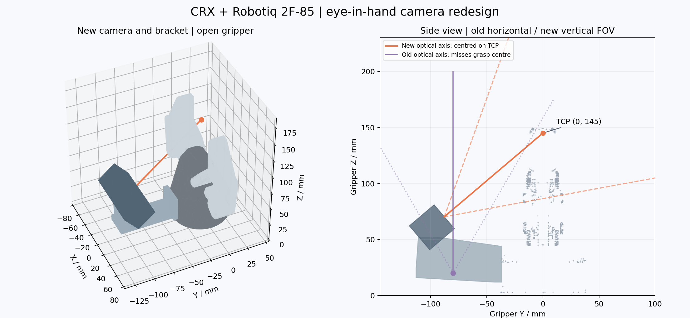
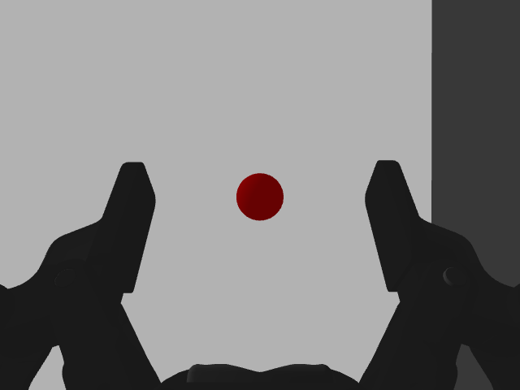

# 末端相机评估与安装

## 原安装的问题

原相机位于 tool_mount 的 `(0, -0.080, 0.020)` m，机身旋转为
`(0, -π/2, 0)`，相机朝向与夹爪伸出方向平行。新增夹爪后的 TCP 位于
`(0, 0, 0.145)` m；转换到旧光学坐标系，其位置约为 `(-0.080, 0, 0.125)` m。
因此 TCP 横向离轴角为 `atan(0.080/0.125) = 32.62°`，超过水平半视场 30°。
旧布局无法把抓取中心放进画面，画面横轴也没有对应两指的开合方向。

旧模型仅为 30×25×20 mm 方块，缺少连接夹爪的支架、镜头外观；镜头坐标原点位于机身内部。
0.1 m 的近裁剪距离对末端近距离观察留出的余量也较小。

## 新方案

采用通用短距离 RGB-D **仿真模型**，外形与参数不代表任何具体商用相机。
保持夹爪和 TCP 不变，把相机通过侧面支架固定在 Robotiq 基座上。

| 项目 | 新参数 |
| --- | --- |
| 机身中心，相对夹爪基座 | `(0, -0.100, 0.060)` m |
| 机身姿态 RPY | `(0, -40.365°, 90°)` |
| 瞄准点 | TCP `(0, 0, 0.145)` m |
| 中央镜头，相对机身 | 沿机身 X 前移 16 mm |
| 镜头到 TCP | 115.24 mm |
| 外壳尺寸 | 80 mm 宽 × 28 mm 高 × 26 mm 深 |
| 外观 | 深灰壳体、黑色前面板、三个蓝色镜头 |
| 支架 | 侧安装板、横向悬臂、相机支座，均有碰撞体 |
| 质量 | 相机 0.12 kg；支架约 0.0936 kg |
| 惯性 | 机身按长方体计算；支架按三个铝制长方体组合计算 |
| 视场 | 水平 75°，垂直约 59.84° |
| 图像 | 640×480，30 Hz 配置更新率 |
| 深度范围 | 0.03～2.0 m（仿真配置） |

相机沿侧面斜看两指之间，保留了夹爪在图像下方的轮廓作为抓取参考。
镜头光轴穿过 TCP，画面左右对应两指的开合方向。抓取区域的 85 mm 宽度位于视场内。
支架与活动手指在 Y 方向上的保守包围盒间隙超过 19 mm。
仅豁免支架与夹爪基座、支架与相机的两对固定装配接触；相机与手指及其他机器人连杆的碰撞检查保持启用。



## 坐标与话题

固定链：

```text
robotiq_85_base_link
└── camera_mount_link
    └── camera_link
        └── camera_sensor_frame
            └── camera_optical_frame
```

`camera_link` 的 X 朝向镜头；`camera_sensor_frame` 位于镜头中心，X 仍朝前。
`camera_optical_frame` 在同一原点，Z 朝前、X 朝右、Y 朝下。

镜头偏移通过固定关节表达，不能只写在 Gazebo sensor 的 pose 中：实测 Gazebo Classic
进行 URDF 固定关节合并时会覆盖 sensor 内部偏移，导致图像深度与 TF 原点不一致。

保留以下话题，header 均使用 `camera_optical_frame`：

- `/camera/image_raw`
- `/camera/camera_info`
- `/camera/depth/image_raw`
- `/camera/depth/camera_info`
- `/camera/points`

## 验证

- 模型展开和 ROS 参数解析通过；包括视场、镜头坐标与传感器方向、手指间隙在内的 5 项自动测试通过。
- Gazebo 实际发布 RGB、深度图、内参及点云。
- MoveIt 检查 17 个从全开到全闭的夹爪状态，未检测到相机或支架碰撞。
- 将半径 8 mm 的红色测试球放在 TCP，目标出现在画面中央；理论中心球面深度约 107.24 mm，实测约 106.75 mm。
- 下图为实际 Gazebo 相机图像，测试球仅用于验证，测试结束已删除。



本次验证针对安装、视场、深度坐标及夹爪开合间隙；物体本身可能遮挡视线，
机械臂折叠姿态仍须由 MoveIt 碰撞检查约束。当前旧 `sensors_3d.yaml` 的 Kinect 配置
尚未接入该相机，本次不将模型和相机话题发布视为完成了视觉避障或抓取识别。

## 修改文件与启动

- `crx_description/urdf/camera/camera.xacro`：重建相机外壳、镜头、惯性、光学坐标及传感器配置。
- `crx_description/urdf/camera/camera_mount.xacro`：新增支架及其碰撞体、组合惯性。
- `crx_description/urdf/crx10ia_l/crx10ia_l_macro.xacro`：安装支架与相机，设置瞄准 TCP 的姿态。
- `crx_moveit_config/config/crx10ia_l.srdf`：固定装配处的碰撞豁免。
- `crx_control/test/test_camera_geometry.py`、`CMakeLists.txt`、`package.xml`：相机几何回归测试及依赖。

新增 Xacro 文件需要重新安装；现有 description 的 CMake 安装规则已覆盖 urdf 目录。

```bash
cd /home/anl/git/bot/my_ws
source /opt/ros/humble/setup.bash
colcon build --symlink-install --packages-select crx_description crx_control crx_moveit_config crx_bringup
source install/setup.bash
ros2 launch crx_bringup gazebo_moveit.launch.py
```

必须关闭原仿真后重新启动，运行中的 robot_description 不会自动替换。
