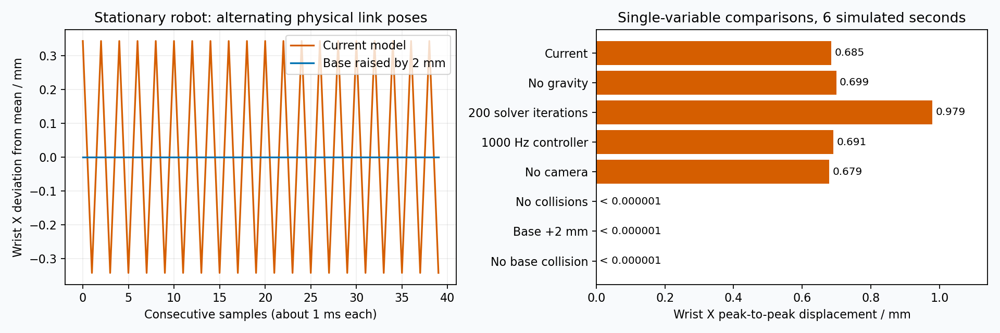

# Gazebo 静止高频抖动诊断

## 结论

直接原因是底座碰撞网格穿入地面，同时又通过 `world_to_base` 固定在世界坐标系。
地面接触约束尝试将底座推出，固定关节要求底座保持原位，产生持续的求解振荡并传递到整条机械臂。
这是此前接入夹爪、固定底座时遗漏的安装间隙检查，不是新相机的直接故障。

- `crx_description/meshes/crx10ia_l/collision/link_base.stl` 乘以 URDF 的 0.001 缩放后，最低 Z 为 **-0.00082569 m**。
- `crx_control/urdf/crx10ia_l_gazebo.xacro` 中 `world_to_base` 固定原点为 `(0, 0, 0)`。
- 默认地面在 Z=0，因此初始穿透约 **0.826 mm**。
- 相邻物理步的腕部位置近乎交替，周期约两个 1 ms 物理步，对应约 500 Hz。

## 对照实验

使用 ROS 2 Humble、Gazebo 11.10.2、gazebo_ros2_control 0.4.10。
仅操作 `/tmp/crx-jitter` 中的临时模型、配置和世界；实验 ROS_DOMAIN_ID=77、
Gazebo master 端口 11358，与用户仿真隔离。三个控制器激活后等待 3 秒，
再采样 6 秒仿真时间。通过 Gazebo state 插件以目标 1000 Hz 记录真实 link_states，
每组收到约 5840～5980 帧，而非仅根据 robot_state_publisher 的 TF 作判断。

实验世界使用 ODE quick solver、1 ms 步长、默认对照 50 次迭代、SOR=1.3；
保持与当前模型同样的零位静止控制，逐项改变一个因素。

| 对照条件 | 腕部 link_6 的 X 峰峰值 / mm |
| --- | ---: |
| 当前模型 | 0.684780 |
| 关闭重力 | 0.699096 |
| 求解器迭代 50 → 200 | 0.978691 |
| 控制频率 100 → 1000 Hz | 0.691077 |
| 移除相机及支架 | 0.678690 |
| 移除全部碰撞体 | 0.000000 |
| 底座固定原点上移 2 mm | 0.000000 |
| 仅移除底座碰撞体 | 0.000000 |

表中的 0.000000 实测约 10⁻¹² mm，视为浮点数值误差，而非声称数学上的绝对零。
抬高 2 mm 和仅删除底座碰撞体两组均消除了抖动，并保留其他连杆的原始控制、惯性和碰撞配置。

## 为什么先前关节状态检查没有发现

基准组 /joint_states 中关节角度的峰峰值仅约 10⁻¹⁵ rad，但 Gazebo 腕部 X 峰峰值约 0.685 mm。
关节读数 100 Hz 与 1000 Hz 物理步之间存在同步抽样，可能总是采到交替振荡的同一相位。
此外关节角度本身不描述底座固定约束和连杆约束中的全部位置误差。
因此“关节角稳定”不能证明 Gazebo 实体姿态稳定；本次采用物理引擎的连杆位姿直接检查。

## 已排除的主因及次要问题

- 移除相机和支架后仍有约 0.679 mm 抖动，相机负载不是本次主因。
- 关闭重力没有消除抖动，不能将其简单归因于重力下垂。
- 单独提高控制频率没有消除抖动；源码中控制器 read/update 按控制周期执行，
  write 仍在每个物理步执行。参见 [gazebo_ros2_control 插件源码](https://raw.githubusercontent.com/ros-controls/gazebo_ros2_control/humble/gazebo_ros2_control/src/gazebo_ros2_control_plugin.cpp)。
- 位置接口通过 SetPosition/SetVelocity 写入仿真，不是已调好的力矩伺服系统；
  参见 [安装版本 0.4.10 的 GazeboSystem 源码](https://raw.githubusercontent.com/ros-controls/gazebo_ros2_control/0.4.10/gazebo_ros2_control/src/gazebo_system.cpp)。
- 增加求解器迭代到 200 没有解决约束冲突，本组振幅反而增加。
- 机械臂原始质心和惯性较粗略、关节 effort=0、缺少阻尼等仍值得后续整理，
  但无需修改它们，消除底座穿透就足以使本次静止实验稳定。

## 已实施修复

已在 `crx_control/urdf/crx10ia_l_gazebo.xacro` 把固定底座的 Z 原点设为 **0.002 m**，
保留底座固定和完整碰撞体。此项已在临时模型中验证；模型底面与地面会留约 1.174 mm 间隙。
另一种更精确的处理是修整底座碰撞网格，使其底面与安装平面一致，再留小量数值余量。
不建议靠提高控制频率、任意放大阻尼或删除全部碰撞体掩盖问题。

新增回归检查会读取真实底座 STL 网格、缩放与固定关节变换，验证碰撞体最低点高于地面，
并确认底座固定关节和碰撞体没有被移除。控制器、惯性与物理求解参数保持原配置。

测试结论针对当前静止工况和已执行的动作，不代表所有姿态、接触抓取工况均已验证。

### 修复后的回归结果

- 6 项自动测试通过，包含底座碰撞网格地面间隙检查。
- 实际修复模型再次采样 6 秒静止工况，5783 帧连杆状态，腕部 X 峰峰值约 1.6×10⁻¹² mm，已降至数值误差量级。
- 夹爪直接闭合、直接张开、MoveIt ExecuteTrajectory 闭合均成功；2.5 秒轨迹的 10%～90% 行程实测均为 2.000 秒。
- 腕部保持稳定，关节名称广播检查通过。

当前为 symlink-install，已有模型文件修改会立即反映到安装路径；关闭原仿真并重新启动即可加载修复。
